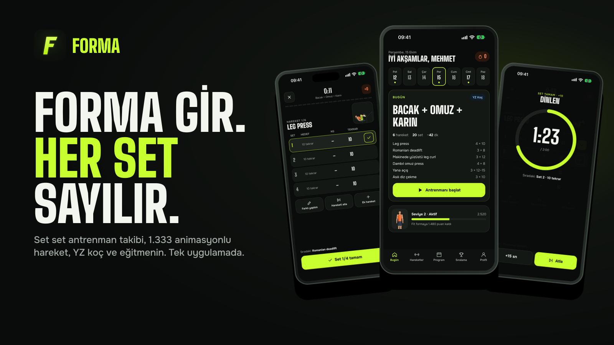
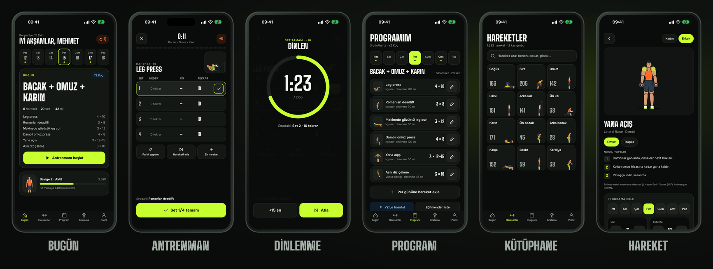

  

<h3 align="center">Salonda telefonla boğuşma. Seti işaretle, gerisini FORMA sayar.</h3>

  FORMA bugünkü antrenmanını önüne koyar, dinlenmeni sayar, ilerlemeni hatırlar. 
  <b>1.333 animasyonlu hareket · YZ koç · gerçek eğitmen · haftalık lig</b>

  
  
  
  

  <a href="https://mhmtmutlu.github.io/forma-app/"><b>Tanıtım sayfası</b></a> ·
  <a href="https://mhmtmutlu.github.io/forma-app/gizlilik/">Gizlilik</a> ·
  <a href="https://mhmtmutlu.github.io/forma-app/kvkk/">KVKK</a> ·
  <a href="https://mhmtmutlu.github.io/forma-app/hesap-silme/">Hesap silme</a> ·
  <a href="mailto:apps.support.mm@gmail.com?subject=FORMA%20erken%20eri%C5%9Fim">Erken erişim iste</a>

---

## Neler var?

| | |
|---|---|
| 🏋️ **Canlı antrenman** | Hareketi animasyonla gör, ağırlığı ve tekrarı tek dokunuşla ayarla, seti işaretle. Dinlenme sayacı kendiliğinden başlar, süre dolunca titreşimle haber verir. |
| 🎞️ **1.333 hareket** | 12 kas grubu: serbest ağırlık, makine, vücut ağırlığı, kardiyo. Her hareket FORMA'nın kendi çizdiği figürle, doğru formuyla oynar. |
| ✨ **YZ koç** | Yaşını, kilonu, boyunu, haftada kaç gün çalışacağını ve hedefini söyle; sana uygun haftalık programı kursun. **İlk YZ programın ücretsiz.** |
| 🧑‍🏫 **Eğitmeninle bağlan** | Davet koduyla bağlan. Eğitmenin programını yazar, antrenmanlarını görür; sen onaylamadan hiçbir program değişmez. |
| 🏆 **Haftalık lig** | Set, tamamlanan gün ve kişisel rekor puan kazandırır. Seriyi koru, rozetleri topla. |
| 🔒 **Önce gizlilik** | Hesapsız da kullanılır, veriler önce telefonunda tutulur. Hesabını uygulamadan tek adımda silebilirsin. |

## Ekranlar

## Yakında

- ⌚ **Apple Watch:** bugünün hareketi bileğinde; seti saatten işaretle.
- 🤖 **Android** sürümü.

---

Bu depo FORMA'nın herkese açık sayfalarını (GitHub Pages) barındırır. Kaynak, özel `forma` deposundaki `apps/site` klasörüdür; buraya `scripts/publish-site.sh` ile kopyalanır, elle düzenlenmez. · Destek: <a href="mailto:apps.support.mm@gmail.com">apps.support.mm@gmail.com</a> · © 2026 Mehmet Mutlu
